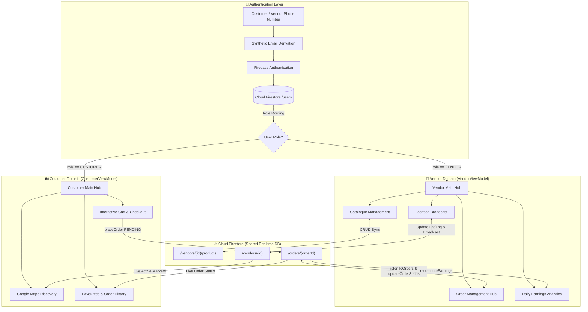

# 🛒 Digital Street Vendor Network (Local Vends)

<div align="center">


<br/>

**A modern Android application built with Jetpack Compose that bridges Mumbai's vibrant street markets with hyperlocal digital commerce.**

*Empowering street vendors to retain loyal customers through disruptions, broadcast live stall locations, manage digital menus, and accept advance pickup orders.*

---

[Key Features](#-key-features) • [Architecture](#-architecture--data-flow) • [Tech Stack](#-tech-stack) • [Database Schema](#-firestore-database-schema) • [Getting Started](#-getting-started) • [Roadmap](#-roadmap)

</div>

---

## 🌟 The Vision & Problem Statement

Street vending is the heartbeat of urban commerce in cities like Mumbai, supporting hundreds of thousands of livelihoods and delivering fresh produce and delicious culinary heritage to neighborhood residents.

However, street vendors regularly face severe operational challenges:
- **Disruptive Relocations & Evictions:** Footfall plummets when municipal zoning or redevelopment drives sellers away from customary spots.
- **Lost Customer Retention:** Loyal buyers cannot locate their regular *chaiwallah*, *fruit vendor*, or *dosa stall* after sudden relocations.
- **Physical-Only Bottlenecks:** Manual order-taking creates long queues during peak rush hours, limiting daily earning capacity.

### 💡 The Solution: Local Vends
**Local Vends** ("Digital Street Vendor Network") provides a lightweight, mobile-first companion platform designed to **complement physical street vending without replacing its spontaneous charm**:
- Vendors broadcast their live street coordinates so regular patrons can always find them.
- Customers can discover open stalls within walking distance, browse live digital menus, and place orders for quick counter pickup or nearby handovers.
- Vendors manage incoming order queues, track daily revenues, and configure direct UPI payments effortlessly.

---

## ✨ Key Features

The app features dedicated, tailored user experiences for two distinct roles:

### 🏪 1. Vendor Portal (Micro-Merchant Command Center)

| Feature | Description |
| :--- | :--- |
| **📦 Dynamic Catalogue Management** | Add, edit, and delete products in real-time. Set prices in Indian Rupees (₹), add descriptions, and toggle instant item availability badges (`isAvailable`) with real-time Firestore synchronization. |
| **📍 Interactive Location Broadcasting** | Set and adjust stall coordinates on an interactive Google Map centered on Mumbai (`19.0760° N, 72.8777° E`). Toggle location broadcasting live so nearby buyers can pinpoint your current setup. |
| **🛎️ Real-Time Order Management** | Tabbed status hub (`All`, `Pending`, `Preparing`, `Completed`, `Declined`) with live Firestore snapshot listening. View item breakdowns, customer phone numbers, pickup mode, and special notes. |
| **🔄 Interactive Order Lifecycle** | Accept incoming orders (`PENDING` ➜ `PREPARING`), decline unavailable requests, or mark them complete (`PREPARING` ➜ `COMPLETED`), notifying the customer pipeline immediately. |
| **📊 Live Earnings & Analytics** | Automatically calculates today's completed revenue (₹) and finished order counts directly from real-time Firestore transactions. Features rating distribution previews and customer reviews. |
| **⚙️ Business Settings & UPI** | Toggle stall open/closed status with one tap. Update operating hours, business title, and UPI virtual payment address for customer settlements. |
| **🧪 Order Workflow Simulator** | Built-in "Simulate Incoming Order" tool that generates realistic test orders for testing without needing a secondary device. |

<br/>

### 🛍️ 2. Customer Portal (Neighbourhood Discovery & Ordering)

| Feature | Description |
| :--- | :--- |
| **🗺️ Hyperlocal Discovery Map** | Interactive Google Map rendering real-time markers for open, broadcasting vendors across Mumbai neighborhoods (Dadar, Bandra, Colaba, Andheri, Ghatkopar, etc.). |
| **🔍 Search & Category Filtering** | Fast client-side search by stall name, food category, or product name. Instant pill-filter tabs: `All`, `Vegetables`, `Fruits`, and `Street Food`. |
| **📋 Vendor Menu Bottom Sheet** | Tap any vendor pin to slide up stall details, distance, operating hours, and full category-based digital menus. |
| **🛒 Interactive Stepper Cart** | Adjust item quantities (`+` / `-`) with instantaneous subtotal calculation, sticky checkout drawer, and item counters. |
| **🚀 Flexible Pickup Modes** | Choose between **Stall Pickup** (counter collection) or **Nearby Handover** (vendor hands food to customer at a nearby landmark). Add custom preparation notes. |
| **❤️ Bookmarked Favourites** | Save favourite neighbourhood vendors to a dedicated Favourites tab for one-tap discovery and re-ordering. |
| **📜 Order Tracking & History** | View active orders and historical purchases with colour-coded status pills (`Preparing`, `Completed`, `Declined`), timestamps, and total bills. |

---

## 🏗️ Architecture & Data Flow

The project follows the standard **Modern Android Architecture (MVVM)** recommended by Google, utilizing declarative UI with **Jetpack Compose** and reactive data streams via Kotlin **`StateFlow`** and Firebase real-time snapshot listeners.

### System Flow Diagram



---

## 🗄️ Firestore Database Schema

The app synchronizes in real-time with Cloud Firestore structured as follows:

```
firestore-root/
│
├── users/
│   └── {uid}/
│       ├── name: String
│       ├── phone: String
│       ├── role: "VENDOR" | "CUSTOMER"
│       └── createdAt: Timestamp
│
├── vendors/
│   └── {vendorId}/
│       ├── stallName: String
│       ├── isStallOpen: Boolean
│       ├── isBroadcastingLocation: Boolean
│       ├── lat: Double
│       ├── lng: Double
│       ├── operatingHours: String
│       ├── upiId: String
│       └── products/ (subcollection)
│           └── {productId}/
│               ├── name: String
│               ├── price: Double
│               ├── description: String
│               ├── isAvailable: Boolean
│               └── category: String
│
└── orders/
    └── {orderId}/
        ├── customerId: String
        ├── vendorId: String
        ├── items: List<String>
        ├── totalAmount: String
        ├── status: "PENDING" | "PREPARING" | "COMPLETED" | "DECLINED"
        ├── deliveryType: "Stall Pickup" | "Nearby Handover"
        ├── paymentMethod: "UPI" | "Cash on Pickup"
        └── timestamp: Timestamp
```

---

## 💻 Tech Stack & Dependencies

| Layer | Technology | Details |
| :--- | :--- | :--- |
| **Language** | [Kotlin](https://kotlinlang.org/) `2.2.10` | 100% Kotlin codebase with modern coroutines and Compose compiler plugin |
| **UI Framework** | [Jetpack Compose](https://developer.android.com/jetpack/compose) | Declarative UI via Compose BOM `2026.02.01` |
| **Design System** | [Material 3](https://m3.material.io/) | Material You components, adaptive colors, icons, and typography |
| **Maps & Geospatial** | [Google Maps Compose](https://github.com/googlemaps/android-maps-compose) `4.3.3` | Google Maps SDK for Android (`play-services-maps:18.2.0`) |
| **Architecture** | MVVM + Unidirectional Data Flow | `ViewModel`, `StateFlow`, Kotlin Coroutines |
| **Authentication** | [Firebase Auth](https://firebase.google.com/docs/auth) `23.1.0` | Phone-centric authentication with role-based routing |
| **Database** | [Cloud Firestore](https://firebase.google.com/docs/firestore) `25.1.1` | NoSQL document database with offline snapshot listeners |
| **Testing** | [JUnit 4](https://junit.org/junit4/) & Compose UI Test | Local unit tests and instrumented UI tests |

---

## 📁 Repository Directory Structure

```
Digital-Street-Vendor-Network/
├── .github/                                  # GitHub configurations and workflows
├── app/
│   ├── src/
│   │   ├── main/
│   │   │   ├── AndroidManifest.xml           # App manifest, permissions, Google Maps API key
│   │   │   ├── google-services.json          # Firebase configuration file
│   │   │   ├── java/com/example/digitalstreetvendornetwork/
│   │   │   │   ├── MainActivity.kt           # App entry, login/signup UI, session restore
│   │   │   │   ├── FirebaseAuthRepository.kt # Firebase Auth & user profile repository
│   │   │   │   ├── VendorScreens.kt          # Vendor composables (Catalogue, Map, Orders, Profile)
│   │   │   │   ├── CustomerScreens.kt        # Customer composables (Map, Search, Cart, Orders)
│   │   │   │   ├── viewmodel/
│   │   │   │   │   ├── VendorViewModel.kt    # Vendor Firestore sync, live orders & earnings
│   │   │   │   │   └── CustomerViewModel.kt  # Customer active vendor listener & order placement
│   │   │   │   └── ui/theme/                 # Material 3 Color, Theme, and Typography definitions
│   │   │   └── res/                          # Vector drawables, mipmaps, strings, XML resources
│   │   └── test/                             # Local unit test suite (ExampleUnitTest.kt)
│   └── build.gradle.kts                      # App module Gradle configuration
├── gradle/                                   # Gradle wrapper and version catalog (libs.versions.toml)
├── DEVELOPER.md                              # In-depth architectural & developer documentation
├── README.md                                 # Project overview, features, and setup instructions
├── build.gradle.kts                          # Root Gradle configuration
└── settings.gradle.kts                       # Project settings and plugin repositories
```

---

## 🚀 Getting Started

Follow these steps to set up and run the project locally on your machine.

### Prerequisites
1. **Android Studio**: Install [Android Studio](https://developer.android.com/studio) (Ladybug, Koala, or newer recommended).
2. **Java Development Kit (JDK)**: JDK 11 or higher configured.
3. **Android SDK**: API level 34 through 37 installed via the SDK Manager.
4. **Android Device or Emulator**: Running Android 7.0 (Nougat / API 24) or higher with Google Play Services enabled.

### 1. Clone the Repository
```bash
git clone https://github.com/Just-Anish/Digital-Street-Vendor-Network.git
cd Digital-Street-Vendor-Network
```

### 2. Configure Android SDK Path
Ensure a `local.properties` file exists in the root directory pointing to your Android SDK:
```properties
# Windows example:
sdk.dir=C\:\\Users\\<YourUsername>\\AppData\\Local\\Android\\Sdk

# macOS/Linux example:
sdk.dir=/Users/<YourUsername>/Library/Android/sdk
```

### 3. Google Maps API Key
The app uses Google Maps SDK. The API key is declared in `app/src/main/AndroidManifest.xml`:
```xml
<meta-data
    android:name="com.google.android.geo.API_KEY"
    android:value="YOUR_GOOGLE_MAPS_API_KEY" />
```
> [!NOTE]
> Make sure **Maps SDK for Android** is enabled on your Google Cloud Console project for this API key.

### 4. Firebase Configuration
The project is configured with Firebase Authentication and Cloud Firestore:
- Ensure `app/src/main/google-services.json` is present.
- In your Firebase Console, ensure **Email/Password Authentication** and **Cloud Firestore** are enabled.

### 5. Build and Run
Build the debug APK using the Gradle wrapper:

```bash
# On Linux/macOS:
./gradlew assembleDebug

# On Windows:
gradlew.bat assembleDebug
```

Install and run directly on your connected emulator or device:
```bash
./gradlew installDebug
```

---

## 🧪 Testing

The test suite covers vendor search query filtering, case-insensitivity, category filters, and product validation:

```bash
# Run local unit tests
./gradlew testDebugUnitTest

# Run instrumented tests on an emulator/device
./gradlew connectedDebugAndroidTest
```

---

## 🗺️ Roadmap & Upcoming Milestones

- [x] **Phase 1: Foundations** — Jetpack Compose UI, phone-based Firebase Auth, and role-based routing.
- [x] **Phase 2: Vendor Hub** — Real-time Firestore catalogue CRUD and manual coordinate pin broadcasting.
- [x] **Phase 3: Customer Discovery** — Live Mumbai Google Map with active vendor markers, category search, and bottom sheet menus.
- [x] **Phase 4: Order Lifecycle** — End-to-end order placement, vendor real-time receiving, and order status transitions (`PENDING` ➜ `PREPARING` ➜ `COMPLETED`).
- [x] **Phase 5: Merchant Analytics** — Automated daily revenue calculation (₹) and completed order counter from Firestore snapshots.
- [ ] **Phase 6: GPS Auto-Location** — Integrate `FusedLocationProviderClient` with `ACCESS_FINE_LOCATION` to auto-detect stall position.
- [ ] **Phase 7: UPI Deep Linking** — In-app intent triggers for GPay / PhonePe / Paytm payments directly to the vendor's UPI ID.
- [ ] **Phase 8: Multilingual Localization** — Multi-language toggle supporting English, हिन्दी (Hindi), and मराठी (Marathi) for vernacular accessibility.
- [ ] **Phase 9: Push Notifications** — Firebase Cloud Messaging (FCM) notifications when an order is placed or status changes.

---

## 🤝 Contributing

Contributions are welcome! If you'd like to improve the app:
1. Fork the repository.
2. Create your feature branch (`git checkout -b feature/AmazingFeature`).
3. Commit your changes (`git commit -m 'Add some AmazingFeature'`).
4. Push to the branch (`git push origin feature/AmazingFeature`).
5. Open a Pull Request.

Please consult [DEVELOPER.md](DEVELOPER.md) for deeper implementation guidelines and architectural decisions.

---

## 📄 License & Acknowledgments

This project is developed under open collaboration for academic and community empowerment purposes.

- Built with ❤️ for street vendors and neighborhood communities across Mumbai.
- Built using [Google Jetpack Compose](https://developer.android.com/jetpack/compose) and [Firebase](https://firebase.google.com/).
